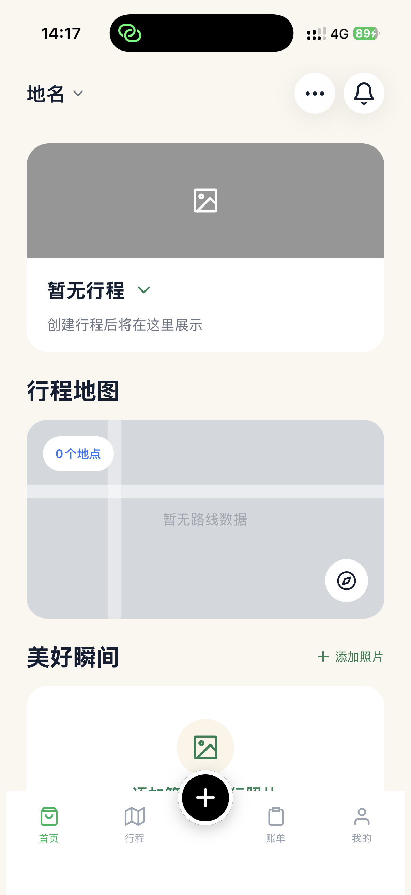
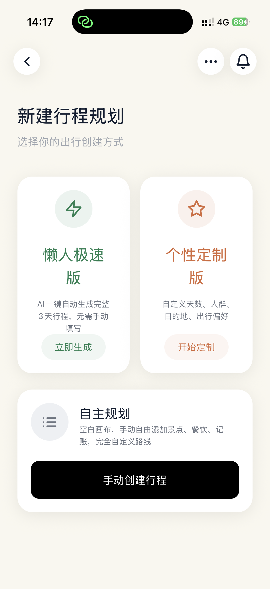
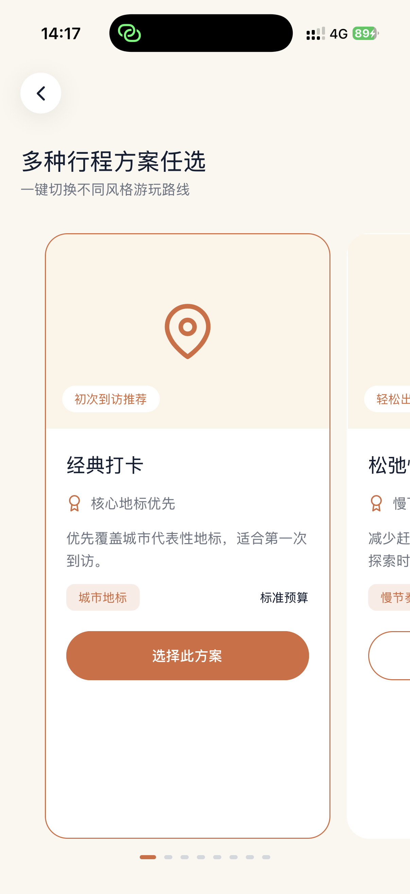
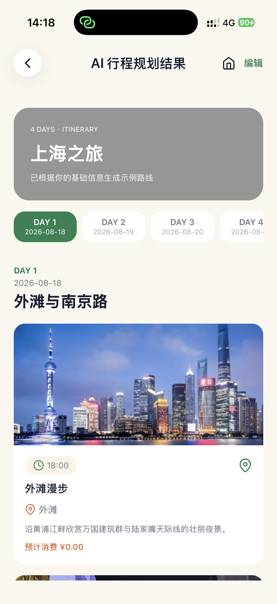
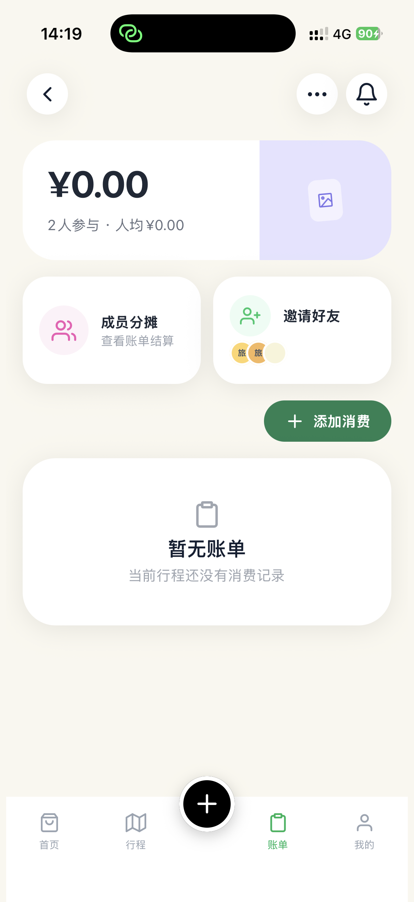

# Wander AI

Wander AI 是一款 AI 旅行规划产品，将城市、天数、预算和兴趣偏好转化为可执行的多日行程，并通过真实 POI 候选约束提升规划可靠性。

## Android Demo

[下载 Wander AI Android Demo](https://github.com/liaolishuwang/wander-ai-portfolio/releases/download/v2.0.2/Wander-AI-Android-v2.0.2.apk)

- 无需注册或登录即可体验 AI 行程生成。
- 游客行程保存在本地，关闭并重启 App 后仍可恢复。
- 登录同一正式账号后，行程可走云端同步（手机 / 电脑一致）。
- APK 为作品集体验版本；Android 安装时可能需要允许浏览器安装未知来源应用。

## 推荐体验路径

1. 打开 App，点击底部中央的“新建行程”。
2. 输入目的地、旅行天数、预算和兴趣偏好（已支持全国地级市选城）。
3. 对比多种行程方案并选择一种。
4. 查看和编辑生成的每日行程。
5. （可选）使用正式账号登录，验证云端行程同步与更快的确认落盘。

## 产品界面

<table>
  <tr>
    <td align="center" width="50%">
      
       
      首页：游客无需登录即可开始规划
    </td>
    <td align="center" width="50%">
      
       
      新建行程：选择极速生成、个性定制或自主规划
    </td>
  </tr>
</table>

<table>
  <tr>
    <td align="center" width="33%">
      
       
      多方案：比较不同风格的旅行路线
    </td>
    <td align="center" width="33%">
      
       
      AI 行程：查看并编辑每日规划
    </td>
    <td align="center" width="33%">
      
       
      旅行账单：记录消费并支持成员分摊
    </td>
  </tr>
</table>

## 核心产品能力

- 根据结构化旅行需求生成多日行程。
- **全国地级市选城**（静态城市库 + 搜索），不再局限于少数城市白名单。
- 提供多种方案，帮助用户比较不同旅行风格。
- 使用真实 POI 候选约束地点选择，减少无依据地点；全国城市支持高德配图兜底。
- 支持行程查看、编辑和持久化。
- 游客无需账号即可体验；正式账号保留云端行程能力，并显著缩短确认落盘等待。

## 近期性能优化（作品集实测）

面向“生成等待过长”的问题，做了链路拆解与分阶段优化（正式账号 + 云端落盘路径）：

| 场景 | 优化前体感（约） | 优化后体感（约） |
|---|---|---|
| 长行程（如 7 天） | 20–30 秒级 | **约 9–14 秒** |
| 模型决策耗时 | 常 10 秒以上 | 可降至约 **1–5 秒**（紧凑决策输出） |

主要手段（产品侧可讲述）：

1. **观测先行**：把服务端耗时与用户体感耗时写入后台日志，定位瓶颈在模型、配图还是落盘。
2. **去掉无效等待**：生成日志与客户端上报不阻塞返回 / 跳转；已有封面不再重复查库。
3. **搜点带图**：高德搜索阶段携带图片字段，减少生成后再打详情图的一轮串行。
4. **紧凑 AI 决策**：模型只输出景点选择与时段，程序确定性展开文案与时间；并对每天活动数做下限兜底（至少 2，目标约 3）。

说明：以上为作品集联调实测数量级，受城市、天数、风格、网络影响，不代表生产 SLA。

## AI 规划机制

规划流程结合候选 POI grounding、结构化 / 紧凑决策生成、服务端校验、确定性修复和超时兜底。AI 请求通过受鉴权的服务端入口完成，模型及地图服务密钥不会下发到客户端。

## 30 Case Evaluation

在固定 30 Case 的 Baseline-vs-Current 作品集评测中：

- Final Quality Pass Rate：**26.7% → 100%**
- POI Candidate Hit Rate：**100%**
- Hallucinated POI：**0**
- Current 原始结果中的 **60 次重复核心 POI** 经 deterministic repair 降至 **0**

该结果来自固定 30 Case portfolio evaluation，用于验证当前方案的方向性改进，不代表生产 SLA，也不是统计意义上的通用模型基准。

## 技术栈

React Native · Expo Router · Supabase Auth / Edge Functions · Qwen · 高德 POI · AsyncStorage · EAS Build

## 当前项目范围

这是面向 AI 产品经理作品集的 Android MVP Demo，重点展示从需求设计、AI 规划链路、安全边界、性能优化到固定 Case Evaluation 的完整产品闭环。当前公开仓库仅提供项目说明和可安装 APK，**不公开**完整业务源码、服务端实现、Prompt、原始评测数据或任何密钥。
